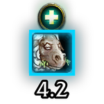

# SkomsHealerCC 1.1.0 (WoW 3.3.5a)

Your healer just got crowd controlled? You see it at once: a large icon of the effect, a big countdown that turns from yellow to red as it runs out, and a sound. The border shows the type of effect (magic, curse, poison, disease, physical), so you know whether it can be dispelled.

- **Where:** arenas by default (option: arena + battlegrounds, or everywhere to test).
- **Which healer:** the same order the raid frames of !!!ClassicAPI (Tsoukie) use: the role the game assigned (group finder), then the class (hunters, rogues, mages, warlocks, warriors and death knights cannot heal), then the teammate's talents (LibGroupTalents-1.0, which WeakAuras and DBM already load). Until the talents are known, priests, druids, paladins and shamans count as healers. You can also list names that are always healers, for every bracket or for 2v2, 3v3 or Solo Queue only.
- **Which crowd control:** stuns, fears, incapacitates, silences, horror, sleep and similar (152 spells). Disarms and roots are optional. The list is the one of SkomsPlateBuffs, checked against the 3.3.5a client data.
- **Look:** icon size, title ("HEALER CC"), timer, spell name, border colour by effect type (magic blue, curse purple, disease green, poison dark green, physical red). Movable.
- **Timer:** big digits drawn with textures (this client never draws text bigger than about 20 px, so a font size cannot make a countdown big). Inside the icon or under it, with a size slider up to 120. The colour goes from yellow to orange to red as the percentage of the total duration left drops (fully red at 25%) (optional). OmniCC is told to stay away from this icon, so you never get two timers.
- **Alert:** a sound (any LibSharedMedia sound) and, optionally, a party chat message.
- Commands: `/shcc` options, `/shcc test`, `/shcc unlock`, `/shcc lock`, `/shcc fonttest`, `/shcc info` (what the icon is drawing).

## Install

Put the `SkomsHealerCC` folder in `Interface\AddOns`.

## Help, missing crowd control and feedback

If your healer is not detected, a crowd control is missing, or something looks wrong, tell me what happened and in which spec:

- **GitHub issues:** https://github.com/Ahmedrn/SkomsHealerCC/issues
- **A comment on the Warperia page**
- **Discord:** `skomzx`

## Credits and inspirations

- The WeakAura **"Healer cc (colored borders)"** by **Elsyn** (retail): the idea, the layout and the border colours.
- The role detection order follows **!!!ClassicAPI** (Tsoukie).
- **LibGroupTalents-1.0** (Zek) for healer detection, **LibSharedMedia-3.0**, **Ace3**.
- Crowd control list from SkomsPlateBuffs (itself started from the BigDebuffs list by Jordon and Tsoukie).

